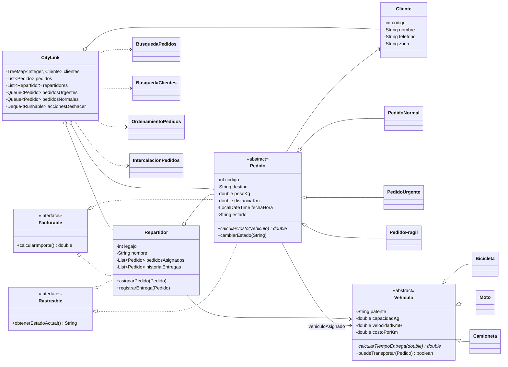

# CityLink – Sistema de gestión de reparto urbano (Entregable 2)

Proyecto Integrador – Programación I – 2026

## Integrantes

- López Pochetti, Ezequiel
- Scibilia, Victoria Belén

## Descripción

CityLink es una aplicación de consola en Java para una empresa de reparto de paquetes. Permite registrar clientes, repartidores y pedidos, encolar los pedidos según su tipo, atenderlos en orden de prioridad, registrar entregas, deshacer operaciones y ordenar, buscar e intercalar pedidos.

El Entregable 2 es la evolución del Entregable 1: se conserva el modelo orientado a objetos y el manejo de excepciones, y se reemplazan los arreglos por las estructuras dinámicas de `java.util`. Además se agregan los algoritmos de búsqueda, ordenamiento e intercalación escritos a mano.

## Requisitos, compilación y ejecución

- Java 26 (versión usada en el desarrollo: 26.0.2.1).
- Estructura del proyecto: `src/` contiene los paquetes `modelo`, `excepciones`, `algoritmos` y `app`.

Desde la carpeta raíz del proyecto:

**Linux / macOS**

```bash
javac -encoding UTF-8 -d out $(find src -name "*.java")
java -cp out app.Main
```

**Windows (PowerShell)**

```powershell
javac -encoding UTF-8 -d out (Get-ChildItem -Recurse src -Filter *.java).FullName
java -cp out app.Main
```

También se puede abrir la carpeta en IntelliJ IDEA o VSCode y ejecutar `app.Main`.

## Organización en paquetes

| Paquete | Contenido |
|---|---|
| `modelo` | `Cliente`, `Pedido` (abstracta), `PedidoNormal`, `PedidoUrgente`, `PedidoFragil`, `Vehiculo` (abstracta), `Bicicleta`, `Moto`, `Camioneta`, `Repartidor`, `Rastreable`, `Facturable` y el gestor `CityLink` |
| `excepciones` | `ClienteNoEncontradoException`, `PedidoInvalidoException`, `CapacidadExcedidaException`, `AlmacenamientoLlenoException`, `EstadoInvalidoException` |
| `algoritmos` | `BusquedaPedidos`, `BusquedaClientes`, `OrdenamientoPedidos`, `IntercalacionPedidos` |
| `app` | `Main` (menú y lectura por teclado) |

## Diagrama de clases

El diagrama está en formato Mermaid. Para entregarlo como imagen se puede pegar en <https://mermaid.live> y exportarlo como PNG.



## Estructuras dinámicas de `java.util`

| Estructura | Clase usada | Uso en CityLink |
|---|---|---|
| Árbol de búsqueda | `TreeMap<Integer, Cliente>` | Clientes por código; el listado ordenado sale del recorrido en orden |
| Lista | `ArrayList` | Repartidores, pedidos, pedidos asignados a cada repartidor, historial de entregas y pedidos de cada turno |
| Cola | `ArrayDeque` (como `Queue`) | Una cola de pedidos urgentes y otra de normales, por orden de llegada. Se atiende primero la de urgentes |
| Pila | `ArrayDeque` (como `Deque`) | Deshacer: cada operación (alta de pedido, asignación, cambio de estado, entrega) se apila y "Deshacer" revierte la última |

## Algoritmos escritos por el grupo

No se usan `Collections.sort`, `List.sort` ni `binarySearch` de Java.

- **Búsqueda lineal:** pedido por código (`BusquedaPedidos.buscarLineal`) y cliente por nombre (`BusquedaClientes.buscarLinealPorNombre`).
- **Búsqueda binaria:** pedido por código (`BusquedaPedidos.buscarBinaria`, versión iterativa). Trabaja sobre una copia de la lista ordenada por código.
- **Ordenamiento:** inserción y burbuja (`OrdenamientoPedidos`), por código, distancia, fecha o costo, eligiendo el criterio mediante un parámetro.
- **Intercalación:** `IntercalacionPedidos.intercalar` combina los pedidos de los turnos mañana y tarde, que ya están ordenados por código, con un solo recorrido y sin volver a ordenar.

## Reglas de negocio y valores de los vehículos

Los valores de los vehículos son los de referencia del enunciado, sin cambios.

| Vehículo | Capacidad | Velocidad | Costo por km | Restricción y tiempo extra |
|---|---|---|---|---|
| Bicicleta | 10 kg | 15 km/h | $50 | No transporta pedidos frágiles. Sin tiempo extra |
| Moto | 30 kg | 40 km/h | $120 | 5 minutos extra |
| Camioneta | 500 kg | 30 km/h | $300 | 10 minutos extra |

- Costo del envío = $1000 + (distancia × costo por km). Urgente: +50% sobre ese total. Frágil: +$800. Normal: sin recargo.
- Estados: PENDIENTE → EN_CAMINO → ENTREGADO. CANCELADO solo desde PENDIENTE.
- Los pedidos cancelados se saltean al atender el siguiente pedido.

### Decisión de diseño: costo estimado

El costo de un pedido depende del vehículo con el que se transporta. Para poder ordenar por costo antes de que un pedido tenga vehículo asignado, el sistema lo estima con una **moto de referencia**. Cuando el pedido ya tiene vehículo, se usa el costo real. En el listado, los costos estimados se indican como "Costo estimado (moto de referencia)".

## Menú principal

1. Gestión de clientes (registrar, eliminar, buscar por código, buscar por nombre, listar ordenado por código)
2. Gestión de repartidores (registrar, eliminar, listar)
3. Registrar un pedido (lo encola y registra la operación en la pila)
4. Atender el siguiente pedido (urgentes primero)
5. Registrar una entrega / cambiar estado
6. Deshacer la última operación
7. Ordenar y listar pedidos (criterio y algoritmo a elección)
8. Buscar un pedido por código (lineal o binaria)
9. Intercalar los pedidos de dos turnos
10. Salir

Datos precargados al iniciar: 5 clientes (códigos 1 a 5), 3 repartidores (101 bicicleta, 102 moto, 103 camioneta) y 8 pedidos (1001 a 1008) de los tres tipos.

| Pedido | Tipo | Peso (kg) | Distancia (km) | Turno |
|---|---|---|---|---|
| 1001 | Normal | 2 | 3 | Mañana |
| 1002 | Urgente | 4 | 5 | Tarde |
| 1003 | Frágil | 3 | 7 | Mañana |
| 1004 | Normal | 5 | 4 | Tarde |
| 1005 | Urgente | 1 | 6 | Mañana |
| 1006 | Frágil | 8 | 2 | Tarde |
| 1007 | Normal | 12 | 8 | Mañana |
| 1008 | Urgente | 6 | 10 | Tarde |

## Pruebas

Todas las pruebas parten del sistema recién iniciado con los datos precargados.

### Pedidos pendientes y cancelados

| # | Tipo | Pasos | Resultado esperado |
|---|---|---|---|
| 1 | Normal | Menú 5 → pedido 1002 → cancelar. Menú 4 → legajo 101 | Se cancela el 1002 y se atiende el 1005 (siguiente urgente), no el 1002 |
| 2 | Normal | A continuación, menú 6 (deshacer) | El 1005 vuelve a PENDIENTE y el 1002 sigue CANCELADO |
| 3 | Borde: estructura vacía | Cancelar los pedidos 1001 al 1008. Menú 4 → legajo 102 | Error: No hay pedidos pendientes. El programa sigue funcionando |

### Ordenar por costo

| # | Tipo | Pasos | Resultado esperado |
|---|---|---|---|
| 4 | Normal | Menú 7 → criterio 4 (costo) → algoritmo 1 (inserción) | Orden: 1001 ($1360), 1004 ($1480), 1007 ($1960), 1006 ($2040), 1002 ($2400), 1005 ($2580), 1003 ($2640), 1008 ($3300). Todos con costo estimado |
| 5 | Normal | Igual que la prueba 4 con algoritmo 2 (burbuja) | El mismo orden que con inserción |
| 6 | Normal | Atender el siguiente pedido con el legajo 101 (se asigna el 1002 a la bicicleta) y repetir la prueba 4 | El pedido asignado muestra su costo real con la bicicleta ($1875 para el 1002) y se reordena según ese valor |

### Clientes

| # | Tipo | Pasos | Resultado esperado |
|---|---|---|---|
| 7 | Normal | Menú 1 → opción 4 → `Ana Pérez` | Muestra el cliente 1 |
| 8 | Normal | Menú 1 → opción 4 → `ana pérez` | El mismo cliente (no distingue mayúsculas) |
| 9 | Normal | Menú 1 → opción 3 → `2` | Muestra a Luis Gómez |
| 10 | Normal | Menú 1 → opción 5 | Lista los 5 clientes ordenados por código |
| 11 | Borde: inexistente | Menú 1 → opción 4 → `Zzz` | Error: No se encontró el cliente: Zzz |
| 12 | Borde: estructura vacía | Eliminar los 5 clientes y buscar por nombre | Error: No se encontró el cliente |

### Repartidores

| # | Tipo | Pasos | Resultado esperado |
|---|---|---|---|
| 13 | Normal | Menú 2 → opción 3 | Lista los repartidores 101, 102 y 103 con su vehículo y patente |
| 14 | Normal | Registrar el legajo 104 (moto, patente D400DDD) y listar | Aparecen 4 repartidores |
| 15 | Normal | Eliminar el 104 y listar | Vuelven a ser 3 |
| 16 | Borde: inexistente | Eliminar el legajo 999 | Error: No existe un repartidor con legajo 999 |
| 17 | Borde: estructura vacía | Eliminar los tres repartidores y listar | No hay repartidores registrados. |
| 18 | Borde: un solo elemento | Eliminar dos repartidores y listar | Muestra únicamente el que queda |

### Búsqueda binaria e intercalación

| # | Tipo | Pasos | Resultado esperado |
|---|---|---|---|
| 19 | Normal | Menú 8 → búsqueda binaria → `1005` | Pedido encontrado |
| 20 | Borde: inexistente | Menú 8 → búsqueda binaria → `9999` | No existe un pedido con ese código. |
| 21 | Normal | Menú 9 | Lista del 1001 al 1008 en orden. Mañana: 1001, 1003, 1005, 1007. Tarde: 1002, 1004, 1006, 1008 |

## Manejo de excepciones

Las excepciones propias se lanzan en el modelo y en el gestor, se propagan con `throws` y se capturan en el menú (`Main`), que informa el error y sigue funcionando. Los datos inválidos por teclado (por ejemplo, texto donde se espera un número) se capturan con `NumberFormatException`.

## Declaración de uso de IA

- **Herramienta:** Claude (Anthropic).
- **Para qué se usó:**
  - revisar el proyecto contra las consignas del enunciado
  - detectar errores y faltantes respecto del Entregable 2
  - proponer las correcciones: pedidos cancelados que no deben atenderse, ordenamiento por costo con un vehículo de referencia, búsqueda lineal de cliente por nombre en el paquete `algoritmos` y gestión de repartidores (listado y baja)
  - elaborar los pasos de prueba y este README
- **Cómo se verificó el resultado:** el grupo recompiló el proyecto, ejecutó el menú siguiendo cada caso de prueba y comparó el resultado con el esperado. Cada integrante revisó y puede explicar el código entregado.
